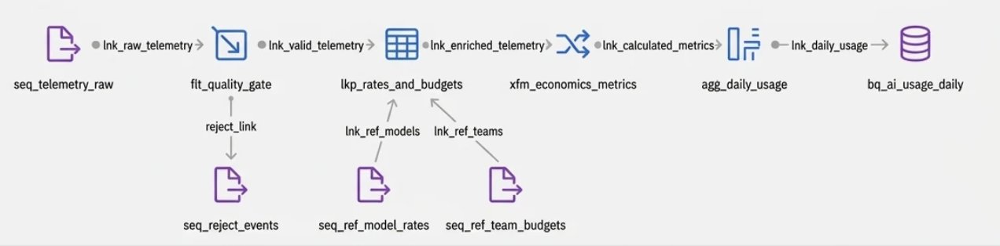

# Job DataStage: `jb_ai_economics_etl`

Parallel Job de IBM InfoSphere DataStage que toma los logs diarios/horarios de telemetría y los maestros de tarifas y presupuestos para generar las 16.200 filas consolidadas de `ai_economics.ai_usage_daily` (180 días, 6 equipos, 5 modelos, 3 ambientes).



```text
seq_telemetry_raw ──► flt_quality_gate ──► lkp_rates_and_budgets ──► xfm_economics_metrics ──► agg_daily_usage ──► bq_ai_usage_daily
                            │                    ▲            ▲
                            ▼                    │            │
                    seq_reject_events   seq_ref_model_rates  seq_ref_team_budgets
                                           (Entire)             (Entire)
```

## Etapas del job

### a) `Sequential_File` (`PxSequentialFile`)
- `seq_telemetry_raw`: lee los logs crudos (`event_timestamp`, `team`, `model`, `environment`, `region`, `requests`, `input_tokens`, `output_tokens`, `avg_latency_ms`, `p95_latency_ms`, `error_count`, `cache_hit_count`).
- `seq_ref_model_rates`: tabla maestra de modelos (`model`, `provider`, `input_rate_usd_per_m`, `output_rate_usd_per_m`, `traffic_share`, `value_multiplier`).
- `seq_ref_team_budgets`: tabla maestra de equipos (`team`, `product`, `daily_budget_usd`).
- `seq_reject_events`: archivo destino para los registros rechazados por el filtro de calidad.

### b) `Filter` (`PxFilter`) — `flt_quality_gate`
Filtra registros con claves nulas o métricas inconsistentes y los manda al `reject_link` sin cortar la corrida:
- Exige `event_timestamp`, `team` y `model` no nulos/vacíos.
- Valida `environment IN ('production', 'staging', 'development')`.
- Exige `requests > 0`, `input_tokens >= 0`, `output_tokens >= 0`, `avg_latency_ms >= 0`, `p95_latency_ms >= avg_latency_ms`, y conteos `error_count` / `cache_hit_count` entre `0` y `requests`.

### c) `Lookup` (`PxLookup`) — `lkp_rates_and_budgets`
Cruza `lnk_valid_telemetry` contra las dos referencias usando particionamiento **`Entire`** (son solo 5 modelos y 6 equipos, así evita reparticionar el flujo principal):
- Por `model`: agrega `provider`, `input_rate_usd_per_m`, `output_rate_usd_per_m`, `traffic_share` y `value_multiplier`.
- Por `team`: agrega `product` y `daily_budget_usd`.

### d) `Transformer` (`PxTransformer`) — `xfm_economics_metrics`
Calcula las métricas derivadas usando *Stage Variables*:
- `svEventDate`: fecha desde `event_timestamp` (`StringToDate(Left(event_timestamp, 10), "%yyyy-%mm-%dd")`).
- `svEnvShare`: peso por ambiente (`0.86` production, `0.10` staging, `0.04` development).
- `svErrorRate` y `svSuccessRate`: `error_count / requests` acotado a `[0, 0.20]`, y `1 - svErrorRate`.
- `svCacheHitRate`: `cache_hit_count / requests` acotado a `[0, 0.70]`.
- `svCostUsd`: `((input_tokens / 1e6) * input_rate_usd_per_m + (output_tokens / 1e6) * output_rate_usd_per_m) * infra_mult * (1 - 0.35 * svCacheHitRate)`, con `infra_mult = 1.18` si `provider = "Self-hosted"` y `1.0` en el resto.
- `svAllocatedBudgetUsd`: `daily_budget_usd * traffic_share * svEnvShare`.
- `svBusinessValueUsd`: `requests * svSuccessRate * value_per_success * value_multiplier`, donde `value_per_success` es `0.028` para `Customer Experience` y `0.041` para el resto.

### e) `Aggregator` (`PxAggregator`) — `agg_daily_usage`
Consolida al grano diario con particionamiento **`Hash`** por `(event_date, team, model, environment)` hasta llegar a los **16.200 registros** finales:
- Claves de grupo: `event_date`, `team`, `product`, `provider`, `model`, `environment`, `region`.
- `Sum`: `requests`, `input_tokens`, `output_tokens`, `cost_usd`, `business_value_usd`.
- `Mean`: `avg_latency_ms` (entero), `error_rate`, `success_rate`, `cache_hit_rate`.
- `Max`: `p95_latency_ms`, `allocated_budget_usd` (para no multiplicar el presupuesto diario si hay varios lotes en el día).

### f) `BigQuery_Connector` (`BigQueryConnectorPX`) — `bq_ai_usage_daily`
Carga la tabla `YOUR_PROJECT_ID.ai_economics.ai_usage_daily` definida en `bigquery/schema.sql` (particionada por `event_date` y clusterizada por `team, model, environment`) y exporta el CSV consolidado a `data/ai_usage_daily.csv`.

## Archivos en esta carpeta

- `README.md`: este diseño del job.
- `jb_ai_economics_etl_flow.jpg`: diagrama visual del flujo del job.
- `source_to_target_mapping.csv`: mapeo columna a columna hacia `ai_economics.ai_usage_daily`.
- `jb_ai_economics_etl.dsx`: exportación XML del job paralelo.
